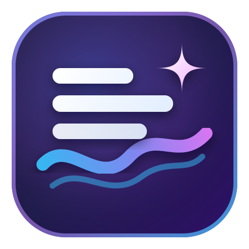

# 🎵 ProPresenter Lyric Animator

<p align="center">
  
</p>

<p align="center">
  <strong>Aplikasi desktop pendamping ProPresenter untuk animasi lirik kinetik bergaya After Effects, sinkronisasi Theme 1:1, pemutaran Media tanpa NDI, dan Web Remote Control Smartphone via QR Code.</strong>
</p>

<p align="center">
  
  
  
  
  
  
</p>

---

## 🌟 Fitur Utama

- 🎨 **28+ Preset Animasi Teks After Effects:** Letter reveals, kinetic word pops, line masks, typewriter, dan worship slow fades dengan kurva bezier After Effects yang halus.
- 〰️ **Continuous Text Effects (Wiggle & Distorsi):** Wiggle posisi, wiggle rotasi, handheld organiknya AE, pulse, glitch, dan gelombang kinetic dengan pengaturan intensitas dan kecepatan mandiri.
- 📐 **Sinkronisasi Theme ProPresenter 1:1:** Membaca font, warna teks, koordinat, ukuran kotak, margin, bayangan (shadow), outline, hingga multi-textbox (kotak teks ganda seperti judul bait + lirik) langsung dari file `.pro` dan Theme ProPresenter.
- 🎬 **Media Playback Tanpa NDI:** Memutar video loop background (MP4, MOV, WebM) dan gambar dari ProPresenter Media Bin secara lokal dengan *warm-slot pool* tanpa lag dan tanpa jeda frame awal.
- 📺 **Deteksi Layar Fisik Windows Langsung:** Mendeteksi resolusi native monitor eksternal/proyektor/videotron LED via Win32 API dan membuka fullscreen output satu klik.
- 📱 **Web Remote Control Smartphone via QR Code:** Operator atau Worship Leader (WL) dapat mengontrol on/off animasi, mode Fade/Cut, preset lirik, dan efek teks langsung dari browser HP tanpa perlu install aplikasi apapun.
- ⚡ **Mode Transisi Saat Animasi Off (Fade vs Cut):** Memungkinkan perpindahan slide tetap menggunakan crossfade halus tanpa jeda kosong atau cut langsung.
- ⌨️ **Shortcut Keyboard & Tombol Cepat Suasana (Mood):** Akses cepat ke preset Worship, Praise, atau Liturgi via tombol F1–F12 yang dapat disesuaikan.
- 🗑️ **Integrasi Clear Layar (F1):** Tombol Clear Layar terintegrasi 2-arah langsung membersihkan layer slide di ProPresenter.

---

## 📋 Persyaratan Sistem

- **Sistem Operasi:** Windows 10 / 11 (64-bit)
- **ProPresenter:** ProPresenter 7.x atau ProPresenter 20.x (Network API aktif)
- **Node.js:** v18.0.0 atau lebih baru (untuk mode pengembangan)
- **Jaringan:** Wi-Fi / LAN yang sama (jika menggunakan fitur Web Remote HP)

---

## 🚀 Panduan Memulai Cepat

### 1. Menjalankan Aplikasi
Cukup klik dua kali file shortcut di folder aplikasi:
```text
Jalankan_Lyric_Animator.bat
```

Atau jika melalui terminal/command prompt:
```bash
# Install dependensi (hanya pertama kali)
npm install

# Build dan jalankan aplikasi
npm run app
```

### 2. Pengaturan di ProPresenter (Sekali Saja)
1. Buka **ProPresenter** $\rightarrow$ menu **Preferences / Settings** $\rightarrow$ **Network**.
2. Centang opsi **"Enable Network"**.
3. Pastikan port jaringan default adalah `50001` (tanpa password atau gunakan default).
4. ProPresenter Lyric Animator akan otomatis terhubung ke ProPresenter dalam hitungan detik.

---

## 🖥️ Antarmuka & Alur Kerja

```
┌────────────────────────────────────────────────────────────────────────┐
│  ProPresenter Lyric Animator                                           │
│  [● Terhubung]  [↻ Reconnect]  [⚙️ Pengaturan]  [🖥️ Monitor 2] [🔴 LIVE] [📱 Kontrol HP] │
├──────────────────────────────┬─────────────────────────────────────────┤
│ 📡 KONEKSI & THEME           │ 📺 LIVE PROGRAM PREVIEW                 │
│  Look Aktif: Minggu          │  ┌───────────────────────────────────┐  │
│  Presentasi: Kasih Abadi     │  │                                   │  │
│  Theme: Modern Minimalis     │  │   "Besar setia-Mu, ya Tuhan..."   │  │
│  Layer: [Media][Slide][Props]│  │                                   │  │
│                              │  └───────────────────────────────────┘  │
│ 🎨 ANIMASI TEKS (AE)         ├─────────────────────────────────────────┤
│  [Worship F3] [Praise F4]    │ ◀ Slide Sebelumnya     ▶ Slide Berikutnya │
│  Preset: Cinematic Blur ★    │ [ bait 1 - baris 1 ]   [ bait 1 - baris 3 ] │
│  Durasi: [===== 1.2s =====]  │                                         │
│  Animasi Off: [ Fade | Cut ] ├─────────────────────────────────────────┤
│  〰️ EFEK TEKS (Wiggle)       │ ⚡ TOOLBAR STATUS:                       │
│  Preset: AE Wiggle Posisi    │ [✨ Animasi: ON]  [〰️ Efek: ON] [🗑️ Clear]│
└──────────────────────────────┴─────────────────────────────────────────┘
```

---

## 📱 Panduan Web Remote Smartphone

Aplikasi ini dilengkapi fitur remote web tanpa perlu instalasi aplikasi:

1. Klik tombol **`📱 Kontrol HP`** di pojok kanan atas header aplikasi.
2. Popup modal akan menampilkan **QR Code** dan URL lokal (contoh: `http://192.168.1.15:4989/#/remote`).
3. Buka kamera smartphone / pemindai QR di HP yang terhubung ke jaringan Wi-Fi yang sama dengan laptop.
4. Halaman kontrol sentuh ramah jempol (*thumb-friendly*) akan terbuka di HP:
   - **Toggle Animasi:** Aktifkan/matikan animasi teks After Effects.
   - **Mode Saat Off:** Pilih transisi Fade halus atau Cut instan saat animasi dimatikan.
   - **Preset & Durasi:** Pilih preset animasi favorit dan sesuaikan durasi.
   - **Efek Teks:** Aktifkan/matikan efek goyang (wiggle), pilih preset, dan geser slider intensitas/kecepatan.
   - **Tombol Clear Layar (F1):** Tombol darurat untuk membersihkan layar lirik secara instan.
5. Begitu HP terhubung, tombol di desktop akan berubah menjadi **`🟢 Terhubung HP`**.

---

## ⌨️ Shortcut Keyboard Bawaan

| Tombol | Fungsi |
| :--- | :--- |
| **F1** | Clear Layar Lirik (Membersihkan lirik di preview dan output live) |
| **F2** | Toggle Animasi Teks (ON = Animasi Kinetik / OFF = Ikut Transisi Slide) |
| **F3** | Mood Cepat: **Worship** (Cinematic Blur & Rise, 2.0s) |
| **F4** | Mood Cepat: **Praise** (Typewriter Reveal, 0.7s) |
| **F5** | Mood Cepat: **Liturgi** (Animasi Off / Bersih ProPresenter) |
| **Panah Kiri ($\leftarrow$)** | Pindah ke Slide Sebelumnya |
| **Panah Kanan ($\rightarrow$)** | Pindah ke Slide Berikutnya |
| **F12** | Buka / Tutup DevTools Konsol Pengembang |

*(Shortcut dan tombol cepat dapat disesuaikan melalui menu **⚙️ Pengaturan**).*

---

## 📂 Struktur Direktori

```text
Lyric-Animator-ProPresenter/
├── electron/
│   ├── main.cjs                   # Entry point aplikasi Electron & manajemen jendela
│   ├── preload.cjs                # Context bridge aman untuk IPC renderer
│   ├── remoteServer.cjs           # Server HTTP statis & WebSocket untuk Remote HP
│   ├── propresenterThemeParser.cjs# Parser file .pro, RTF, Theme & Media ProPresenter
│   └── windowsDisplays.cjs        # Deteksi resolusi monitor fisik Windows via Koffi
├── src/
│   ├── components/
│   │   ├── ProPresenterLiveApp.jsx# Antarmuka utama aplikasi operator desktop
│   │   ├── LiveLyricStage.jsx     # Mesin render animasi lirik After Effects
│   │   ├── ThemedLyricStage.jsx   # Engine perender lirik berbasis Theme 1:1 ProPresenter
│   │   ├── MediaLayer.jsx         # Background video/image player dengan warm pool
│   │   ├── MobileRemoteView.jsx   # Halaman web remote smartphone (#/remote)
│   │   ├── RemoteQrModal.jsx      # Modal popup QR Code di desktop
│   │   ├── SettingsView.jsx       # Halaman pengaturan shortcut & quick presets
│   │   └── FavoriteSelect.jsx     # Dropdown custom dengan pin ⭐ Favorit
│   ├── lib/
│   │   ├── animationPresets.js    # 28+ preset animasi teks After Effects
│   │   ├── textEffectEngine.js    # Mesin loop efek teks (Wiggle, Pulse, Glitch)
│   │   └── propresenterConnector.js# Klien konektor OpenAPI ProPresenter
│   └── styles.css                 # Desain tema gelap terpadu desktop & mobile
├── Jalankan_Lyric_Animator.bat    # Shortcut peluncur aplikasi satu klik
└── PANDUAN_PROPRESENTER.md        # Panduan manual lengkap operator
```

---

## 🛠️ Perintah Pengembangan (Scripts)

| Perintah | Deskripsi |
| :--- | :--- |
| `npm run dev` | Menjalankan Vite dev server di browser |
| `npm run build` | Melakukan kompilasi bundle Vite React ke folder `dist/` |
| `npm run app` | Melakukan build lalu menjalankan aplikasi Electron |
| `npm run dist:win` | Memaketkan aplikasi menjadi installer Windows (`.exe`) dan Portable |

---

## 📄 Lisensi

Didistribusikan di bawah lisensi **MIT**. Bebas digunakan dan dimodifikasi untuk keperluan gereja, ibadah, konser, dan siaran langsung.
